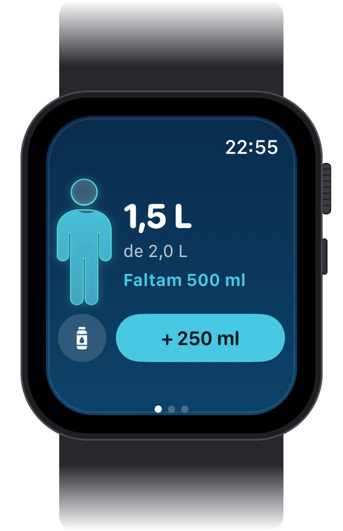
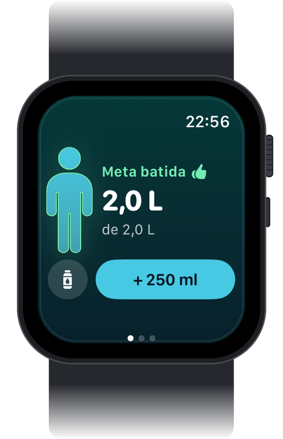
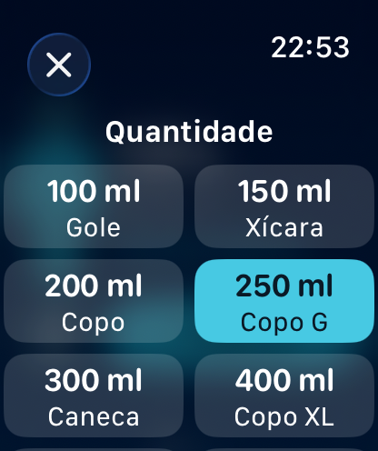
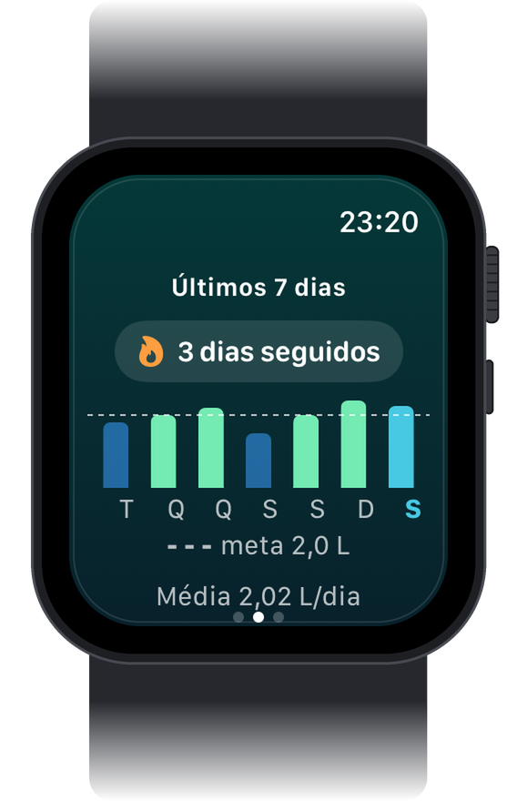
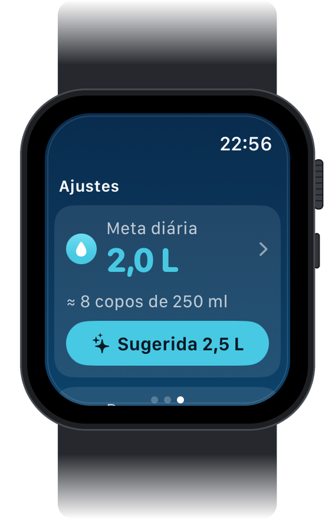

# Water Tracker

[](https://github.com/dimitresouza12/water-tracker-watch/actions/workflows/ci.yml)

App de hidratação para Apple Watch, feito em Swift e SwiftUI. Comecei como projeto de estudo pra aprender o ecossistema da Apple e ainda estou mexendo nele, então tem coisa que falta (veja no fim).

A ideia é registrar a água sem tirar o celular do bolso: um toque no pulso e pronto.

## Telas

<p>
  
  
  
</p>
<p>
  
  
</p>

Os prints são do simulador. Os dias anteriores do histórico são dados de teste que coloquei pra mostrar o gráfico.

## O que já faz

- Registra um volume com um toque, usando a última quantidade escolhida. Dá pra trocar entre 100 ml e 2 L (gole, copo, garrafa...) e também remover o último registro.
- Um corpo que vai enchendo de água conforme o dia avança. A onda da superfície é um `Shape` que eu desenhei com seno, com `level` e `phase` animáveis.
- Meta diária ajustável. Tem uma sugestão baseada no peso (35 ml por kg, arredondada pra múltiplos de 250 ml).
- Histórico dos últimos 7 dias em gráfico de barras (Swift Charts), média da semana e sequência de dias seguidos batendo a meta.
- Lembretes locais num intervalo de horas e janela de horário que você escolhe. A notificação tem um botão "Registrar" que adiciona a água sem abrir o app.
- Cada registro também é salvo no app Saúde, via HealthKit (`dietaryWater`).
- Feedback tátil diferente pra adicionar, remover e bater a meta.
- O total zera sozinho na virada do dia e o valor de ontem vai pro histórico.
- Respeita "Reduzir Movimento" e tem rótulos de acessibilidade nos controles principais.

## Tecnologias

- Swift 5 e SwiftUI
- HealthKit
- Swift Charts
- UserNotifications
- WatchKit (haptics)
- `async/await` nas chamadas ao HealthKit e às notificações
- UserDefaults pra persistência
- XCTest e GitHub Actions

## Como está organizado

```
WaterTracker Watch App/
  WaterTrackerApp.swift     ponto de entrada e delegate das notificações
  WaterStore.swift          estado do app e persistência (UserDefaults)
  HydrationLogic.swift      regras sem UI: meta sugerida, histórico, sequência e média
  HealthKitService.swift    leitura e escrita de água no app Saúde
  ReminderScheduler.swift   agendamento dos lembretes
  ContentView.swift         tela principal e navegação entre as 3 páginas
  BodyView.swift            corpo que enche e a onda
  AmountPicker.swift        escolha da quantidade
  HistoryView.swift         gráfico e sequência
  SettingsView.swift        meta, peso e lembretes
  Theme.swift               cores e estilos compartilhados
Tests/HydrationCoreTests/   testes das regras
```

O `WaterStore` guarda o estado num `ObservableObject` injetado como `environmentObject`, e as views só leem e chamam métodos dele. As contas ficam em `Hydration` (um `enum` sem dependência de SwiftUI), e o que fala com o sistema fica em dois serviços pequenos, um pro Saúde e outro pros lembretes. Começou tudo dentro do `WaterStore`, e eu separei depois pra conseguir testar.

## Testes

As regras de `HydrationLogic.swift` têm testes e rodam sem simulador:

```bash
swift test
```

São 13 testes: meta sugerida (com mínimo e máximo), progresso, chave do dia, ordem dos últimos 7 dias, sequência de dias e média. O `Package.swift` aponta pro mesmo arquivo que o app compila, então não tem código duplicado. As telas, o HealthKit e as notificações ainda não têm teste.

O GitHub Actions roda os testes e compila o app do relógio a cada push.

## Como rodar

Precisa do Xcode e de um simulador de Apple Watch (watchOS 10.6 ou mais novo).

1. Clone o repositório
2. Abra `WaterTracker.xcodeproj`
3. Escolha o esquema `WaterTracker Watch App` e um simulador de Apple Watch
4. Rode

Pra testar o HealthKit num aparelho de verdade, precisa trocar o bundle identifier e o time de assinatura pelos seus.

## O que ainda falta

- Complicação no mostrador (a primeira versão tinha, ainda não trouxe pra essa)
- Ícone do app
- Testes das telas e do HealthKit
- Publicar na App Store

A lista com mais detalhe está nas [Issues](https://github.com/dimitresouza12/water-tracker-watch/issues).

## Autor

Dimitre Souza, estudante de Engenharia de Software na UFC.
[LinkedIn](https://linkedin.com/in/dimitre-souza) · [GitHub](https://github.com/dimitresouza12)
